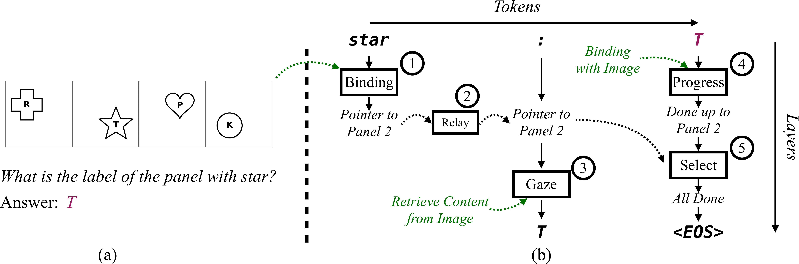

# How VLMs Plan What's Next
### [Project Website](https://plan.baulab.info) | [Paper](https://arxiv.org/abs/2611.21600) | [Demo](https://plan.baulab.info/#demo)

Official code for "How VLMs Plan What's Next". When a vision-language model answers a question about an image, it decides where to look before it looks. This repository lets you see that plan inside Qwen3-VL, patch it, and reproduce every experiment of the paper.

<div align='center'>

</div>

## Setup
```
conda create -n vlm-planning python=3.13
conda activate vlm-planning

git clone https://github.com/rohitgandikota/vlm-planning.git
cd vlm-planning
pip install -r requirements.txt
```
The experiments run Qwen3-VL-8B-Instruct in FP32, which needs a GPU with 48 GB of memory. The model is downloaded from Hugging Face the first time you run anything.

## Start with the notebook
`demo.ipynb` is a short tour on your own images: make an image and a question, see where the binding heads look, patch them, see what the relay heads carry, and then **try your own patch** at any token, layer, and component.

## Make your own data and patch it
Everything reusable lives in `utils/`. An image is a row of panels with one shape and one letter in each, and a patch copies one internal state from a source run into a target run.
```python
from utils.model import load_model
from utils.dataset import draw_strip, one_answer_question
from utils.patching import run_model, make_patch, run_patch

model = load_model()
source = run_model(model, draw_strip(["heart", "star", "square", "circle"], ["P", "U", "A", "G"]), one_answer_question("heart"))
target = run_model(model, draw_strip(["star", "heart", "circle", "square"], ["W", "X", "E", "Z"]), one_answer_question("circle"))

patch = make_patch(source, target, component="residual", token=target.last, source_token=source.last, layer=24)
print(target.answer, "->", run_patch(model, target, patch))      # E -> W: the target now reads the panel the source points to
```
- `utils/dataset.py` builds the images, questions, and source-target pairs of every task in the paper.
- `utils/patching.py` runs the model, records its states, and patches them: the residual, an MLP output, a head's output, query, keys, or values, and blocked attention.
- `utils/heads.py` lists the heads found in the paper (binding, relay, gaze, language, and the others) and has the search that finds them.

## Reproduce the paper
Each mechanism has its own folder. Every file in `main_experiments/` is one experiment of the main paper and runs on its own. It prints its result next to the number in the paper.
```
python binding/main_experiments/03_binding_heads.py --num_pairs 500
```
To run all the experiments of a folder, one after another:
```
python binding/run_binding.py --num_pairs 500
```

| Folder | Paper | What it shows |
|---|---|---|
| `binding/` | Section 4.1 | Binding heads match the requested shape against the image and form a pointer at the shape token |
| `relay/` | Section 4.2 | Relay heads carry the pointer to the token where the answer is written |
| `progress/` | Section 5 | In a list, the model tracks what it has written and selects the next panel, or stops |
| `gaze/` | Section 6.1 | Gaze heads follow the pointer into the image and read what is there |
| `language/` | Section 6.2 | Gaze heads return a concept, and language heads turn it into a word in the question's language |
| `generalization/` | Appendix G | Other model sizes and families, other layouts and prompts, and natural photographs |

Useful arguments, the same for every file:
- `--num_pairs 500` is the number of source-target pairs. The paper uses 500 held-out pairs. A smaller number gives a quick look.
- `--appendix` (for the `run_*.py` files) also runs the appendix experiments in `appendix_experiments/`.
- `--search` (for the `run_*.py` files) also reruns the head searches, the files that start with `00_find_`. They are slow.
- `--coco <folder>` is needed by the few experiments on natural photographs. They read a local copy of COCO.

Results are saved as JSON files in `results/`. The `dataset/` folder records which source-target pairs the model answers correctly with no patch, so the main experiments use the paper's pairs and start at once. A task that is not in it yet runs that check once and saves it there.

## Citing our work
```
@article{gandikota2026plan,
  title={How VLMs Plan What's Next},
  author={Rohit Gandikota and Arnab Sen Sharma and Adam Belfki and David Bau},
  journal={arXiv preprint arXiv:2611.21600},
  year={2026}
}
```
